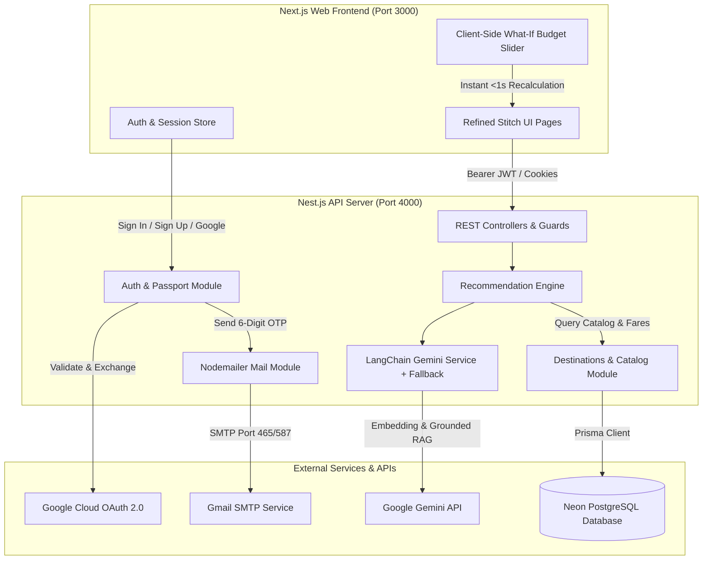
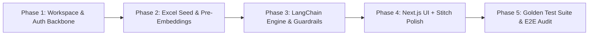

# VROMON — Technical Architecture & Project Execution Plan
**Bangladesh Smart Trip Feasibility & Risk-Aware Travel Recommender**  
*SE331 Software Engineering Capstone | Fall 2026*

---

## 1. Executive Summary & Tech Stack Evolution

The VROMON system uses an enterprise-grade, modern decoupled monorepo architecture. All components utilize **TypeScript** for end-to-end type safety, deterministic mathematical travel feasibility engines, verified 64-district data, and strict, non-hallucinatory AI workflows.

### Modern Production Tech Stack

| Domain | Technology / Library | Role & Justification |
|---|---|---|
| **Language** | **TypeScript 5.x** | End-to-end type safety across client, server, and shared calculation libraries. |
| **Frontend** | **Next.js 14/15 (App Router)** | Server Components, responsive layout, fluid client-side What-If sliders, Tailwind CSS. |
| **UI Design System** | **Google Stitch (`3572637668389846387`) + Manual Polish** | "Bengal Verve" palette (`#145219`, `#2F6B2F`, `#5D9253`, `#FFCB3D`, `#1F2A1F`), Inter typography, zero emojis, refined layouts. |
| **Backend** | **Nest.js 10.x** | Enterprise modular architecture, dependency injection, validation pipes, and robust exception filters. |
| **Authentication** | **Passport.js & JWT** | Dual-strategy (`passport-jwt` + `passport-google-oauth20`), secure HTTP-only cookies, and role-based guards. |
| **OTP Service** | **Nodemailer (Gmail SMTP)** | Automated 6-digit verification codes for first-time registration and password recovery. |
| **Database & ORM** | **PostgreSQL (Neon) + Prisma ORM** | Scalable relational storage with `pgvector` indexing for pre-computed semantic travel embeddings. |
| **Dataset Source** | **`VROMON_64_Districts_Dataset.xlsx`** | Verified 64 districts across 8 divisions, 222 attractions, 338 transport routes, and 768 monthly climate/crowd entries. |
| **AI Orchestration** | **LangChain JS + Google Gemini API** | Zod structured output parsing, dense vector embeddings (`text-embedding-004`), and grounded RAG reasoning (`gemini-2.5-flash`). |
| **Deterministic Math** | **`@vromon/shared` Pure Calculators** | 100% deterministic budget feasibility, available usable time, and multi-factor weighted scoring. |

---

## 2. System Architecture & Component Interactions



---

## 3. Stitch Screen Inventory, Route Mapping & UI Polish Standards

The Stitch project (`projects/3572637668389846387`) defines 26+ screens covering desktop and mobile flows.

### 3.1 Strict UI Refinement & Defect-Fixing Rules (No Blind Copy-Paste)
Stitch provides the visual aesthetic and architectural blueprint, **not** raw production CSS. Every screen implemented in Next.js must undergo active engineering polish to eliminate AI-generated layout defects:
1. **Capsules & Badges:** Fix clipped or overflowing pills. Enforce `flex-wrap gap-2`, consistent horizontal padding, and strict AA/AAA contrast (e.g., `#1F2A1F` dark moss text on `#FFCB3D` amber badges).
2. **Buttons:** Standardize button heights (`44px`–`52px`), icon-to-label alignment, internal padding, and trailing circular coin indicators so buttons never squash or misalign on smaller viewports.
3. **Cards & Grid Symmetry:** Enforce equal card heights in multi-column grids (`h-full flex flex-col justify-between`), uniform border radii (`24px`–`28px`), and balanced inner spacing without crowded corners.
4. **Typography & Font-Size Scaling:** Clamp oversized Stitch display headings (`112px` etc.) into responsive scales (`text-4xl md:text-5xl lg:text-6xl`) so 1280px–1440px laptop screens render cleanly without awkward wrapping, while keeping micro-labels legible (`>= 12px`).
5. **Text Cleanup & Zero Emojis:** Trim excessive filler text across cards and sections. Strictly **zero emojis** anywhere in the UI (use crisp 1.5px stroke Lucide icons only).
6. **Custom Brand Logo Integration:** Cleanly integrate `vromon_logo.png` into the Navbar, Auth headers, and Footer.

### 3.2 Frontend Route Mapping

| Route Path | Stitch Screen Name / ID | Purpose & Key Features |
|---|---|---|
| `/` | `8c3a3c37dee74ba2abafc006d8658989` | **VROMON Full Landing Page:** Hero search, bento grid, how-it-works, destination highlights. |
| `/login` | `e21e4d8c7b384baa80a10d2fd2743175` | **Sign In:** Email + password, Google OAuth trigger, clean error & loading states. |
| `/register` | `862142cd76a74422ab028dd5e6884902` | **3-Step Registration:** Step 1 Account details $\rightarrow$ Mandatory Email OTP $\rightarrow$ Step 2 Preferences $\rightarrow$ Step 3 Welcome. |
| `/verify-otp` | `0438ac0616204b4b995acc461e61f04e` | **OTP Code Verification:** 6 discrete 56px input cells, countdown timer, resend action. |
| `/forgot-password` | `9bb1c0bc01ae4c11a91b2211bab78004` | **Password Recovery:** Request code $\rightarrow$ verify OTP $\rightarrow$ set new password $\rightarrow$ success confirmation. |
| `/plan` | `5cdbb9ba1d9b45cea377ef84130fdca7` | **Plan Your Trip Form:** Spacious natural wish input, budget input, days, travelers, month, origin city. |
| `/results` | `6f24d7d4ed4d4dd8b755142f482565a4` | **Recommendation Dashboard:** Multi-factor score rings, verified feasibility badges, What-If slider, alternative cards. |
| `/destinations/[id]` | `f4e8d60a0bf347e8bf56498b7a6f5c33` | **Destination Detail:** Sajek/Sreemangal overview, Leaflet map, monthly weather/crowd chart, transit timetable. |
| `/compare` | `1db090dd66344df98f1d0805c184d2ea` | **Comparison Matrix:** Side-by-side analysis of up to 3 destinations across cost, hours, and feasibility. |
| `/itinerary` | `0a8fcd5c10764e799526ae8aa78e9388` | **Day-by-Day Itinerary:** 12-hour structured timeline using stored attractions, PDF export. |
| `/plan/[shareId]` | `dbe0ccef13624d9fae5cb22805d8d465` | **Shared Itinerary View:** Read-only 30-day auto-expiring trip plan view (zero PII required). |
| `/trips` | `1432698f2f82494cad1f80b43d638f17` | **My Trips Dashboard:** User's saved trip recommendations and itineraries. |
| `/profile` | `795f3f1de4a1433d875136e09464d67a` | **Profile & Preferences:** User settings, home city selection, budget default tiers. |
| `/admin` | `acba865736d54a18a9c0391abc5a8f12` | **Admin Dashboard:** Platform metrics, query logs, system status. |
| `/admin/destinations`| `6e0c79128a5e42bf9b17de2e5b29aa93` | **Admin Catalog Manager:** Live database editor, batch JSON/Excel uploader, transport fare manager. |

---

## 4. Verified Dataset & Nest.js Backend Architecture

### 4.1 Dataset Ingestion (`VROMON_64_Districts_Dataset.xlsx`)
- **Destinations Sheet (64 Districts across all 8 divisions):** English name (`destination_name`) + Bengali (`name_bn`) for bilingual display, geo-coordinates, cost tier, base hotel/food/local fee estimates, min hours needed, tags, and best months.
- **Attractions Sheet (222 Spots):** Linked attractions with estimated visit hours (`est_hours`) for grounded itinerary generation.
- **Transports Sheet (338 Routes):** Multi-modal transit options (`Bus`, `Train`, `Launch`) with one-way fares and duration from major origin cities.
- **Monthly Conditions Sheet (768 Rows):** Full 12-month weather ratings (`1-5`), seasonal weather notes, and crowd tiers (`Low`, `Medium`, `High`).
- **Pre-Computed Embeddings:** Seed script parses the Excel workbook, populates Neon PostgreSQL via Prisma, and stores `text-embedding-004` (768-dim) vectors upfront for every destination.

### 4.2 Nest.js Backend Modules

```
apps/api/src/
├── app.module.ts
├── main.ts
├── auth/
│   ├── auth.controller.ts
│   ├── auth.service.ts
│   ├── auth.module.ts
│   ├── strategies/
│   │   ├── jwt.strategy.ts
│   │   └── google.strategy.ts
│   ├── guards/
│   │   ├── jwt-auth.guard.ts
│   │   └── google-auth.guard.ts
│   └── dto/
│       ├── register.dto.ts
│       ├── login.dto.ts
│       └── verify-otp.dto.ts
├── mail/
│   ├── mail.service.ts          # Nodemailer SMTP (mahmudulhaquerifat@gmail.com)
│   └── mail.module.ts
├── ai/
│   ├── ai.service.ts            # LangChain + Gemini + Fail-Safe Fallback
│   ├── ai.module.ts
│   ├── prompts/
│   │   ├── intent-extraction.ts
│   │   ├── grounded-reason.ts
│   │   └── itinerary-planner.ts
│   └── schemas/
│       └── parsed-intent.schema.ts
├── recommendations/
├── destinations/
├── itineraries/
├── shared-plans/
└── admin/
```

---

## 5. AI Features Optimization & Faculty Demo Reliability Guardrails

To guarantee **zero errors, zero hallucinations, and rapid responses** during live faculty evaluations:

### 5.1 AI-1: Multi-Intent Conversational Query Extraction (Zod Structured Output)
- **Model:** `gemini-2.5-flash` at `temperature: 0.1` wrapped with `model.withStructuredOutput(ZodSchema)`.
- **Multilingual Handling:** Natively understands English, Bangla, and Banglish inputs.
- **Real-World Conversational Parsing:** Handles compound questions like:
  *"hey i want to go to khulna what are the places to see around, what kind of food i can explore there, i have 10k budget will it be suffecient and we are 2 people where can we stay what are the hotel price rates"*
- **Extracted Schema:**
  ```typescript
  interface ParsedTravelIntent {
    target_destination_hint?: string; // e.g. "Khulna"
    inferred_budget?: number;         // e.g. 10000
    inferred_travelers?: number;      // e.g. 2
    inferred_days?: number;           // e.g. 2 (default weekend)
    detected_tags: string[];          // e.g. ["food", "heritage", "river"]
    detected_mood: string;            // e.g. "cultural-food"
    seasonal_hints: string[];         // e.g. ["winter"]
    user_questions: {
      asks_places: boolean;
      asks_food: boolean;
      asks_budget_sufficiency: boolean;
      asks_hotel_rates: boolean;
    };
  }
  ```

### 5.2 AI-2: Pre-Computed Vector Cache (<1-2s Search Latency)
- All 64 destination embeddings (`text-embedding-004`) are cached in PostgreSQL (`pgvector`).
- Live requests embed **only** the incoming user wish and perform cosine similarity scoring against cached vectors:
  $$\text{Cosine}(\vec{Q}, \vec{D}) = \frac{\vec{Q} \cdot \vec{D}}{\|\vec{Q}\| \|\vec{D}\|}$$

### 5.3 AI-3 & AI-4: Pure Math Grounding (AI-5 Compliance)
- The LLM **never calculates** costs, transit times, or scores.
- `@vromon/shared` computes round-trip transport, hotel rooms (`Math.ceil(travelers / 2)`), food, local fees, 10% buffer, and usable hours (`days * 12 - travel_hours`).
- Verified facts, attractions (`attraction` table), and exact BDT breakdowns are injected into the LangChain prompt so the AI directly answers the user's specific sub-questions (places, food, sufficiency verdict, hotel rates) without fabricating a single number.

### 5.4 Fail-Safe Graceful Fallback (Demo Safety Net)
- **Strict Timeout (4s) + Retry Policy:** If campus WiFi is unstable or Gemini hits rate limits/errors, `AiService` seamlessly triggers a deterministic template engine that generates clean, accurate reasoning and itineraries from the stored database rows—guaranteeing the UI never crashes or hangs during live demonstrations.

---

## 6. Implementation Roadmap & Execution Milestones



1. **Phase 1: Workspace & Auth Backbone**
   - Setup npm workspaces monorepo (`apps/web`, `apps/api`, `packages/shared`).
   - Implement Nest.js Auth (Passport JWT, Google OAuth 2.0) and Nodemailer OTP verification (`mahmudulhaquerifat@gmail.com`).
2. **Phase 2: Excel Dataset Seeding & Pre-Embeddings**
   - Define Prisma schema supporting bilingual names (`name_bn`), 12-month climate/crowd, transport options, attractions, and `pgvector` embeddings.
   - Build seed pipeline to ingest `VROMON_64_Districts_Dataset.xlsx` and pre-compute 768-dim vectors.
3. **Phase 3: LangChain Gemini Engine & Guardrails**
   - Build `AiService` with Zod structured output, multi-intent conversational parsing, grounded RAG reasoning, and deterministic fail-safe fallback.
4. **Phase 4: Next.js Frontend with Stitch Design Polish**
   - Build all Next.js App Router pages following the Stitch blueprint while applying manual UI fixes (capsules, buttons, equal-height cards, responsive typography, zero emojis, `vromon_logo.png`).
   - Connect client-side What-If budget slider (`<1s` instant recalculation), Leaflet interactive maps, and PDF/30-day share export.
5. **Phase 5: Golden Faculty Demo Verification**
   - Run automated tests on boundary budget math (`Fits`, `Tight`, `Over`, `Discard`).
   - Verify live OTP emails, Google OAuth flow, and test golden conversational queries (including the Khulna 10k 2-person food/hotel/attractions benchmark).
