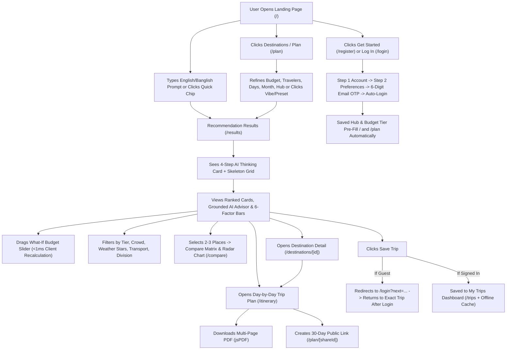

# VROMON — User-Perspective Functional Workflow Verification Report

> **Verified Date:** 2026-11-27  
> **Project:** VROMON — Bangladesh Smart Trip Feasibility & Risk-Aware Travel Recommender (SE331 Capstone — Group 6)  
> **Environment Verified:** Next.js 14 (`apps/web`) + NestJS 10 (`apps/api`) + `@vromon/shared` Pure Math + Neon PostgreSQL (`70` destinations) + Google Gemini AI + Gmail SMTP (`LIVE_READY`)

---

## 1. End-to-End User Journey Map



---

## 2. Executive Summary of Verification Status

| Workflow ID | User-Facing Journey | Primary Routes | Backend / AI / DB Execution | Verified Status |
|---|---|---|---|---|
| **WF-01** | Landing Page Discovery & Instant Prompt Search | `/` -> `/results` | `GET /api/destinations`, URL param handoff | **PASS (Verified Live)** |
| **WF-02** | Dedicated Trip Planner (Prompt, Vibes, Presets, Sliders & Catalog) | `/plan` -> `/results` | Live pill extraction, slider-only fallback query, 70-spot filterable catalog | **PASS (Verified Live)** |
| **WF-03** | AI Recommendation Engine, What-If Slider & Smart Filters | `/results` | `POST /api/recommendations` (Gemini Intent + 768-d Vector + 6-Factor Math + Top-4 AI Reasons) | **PASS (Verified Live)** |
| **WF-04** | Side-by-Side Destination Comparison & Radar Analytics | `/compare` | Pure `@vromon/shared` live budget/days/traveler recalculation + Recharts Radar | **PASS (Verified Live)** |
| **WF-05** | Destination Deep-Dive, 12-Month Climate & Map | `/destinations/[id]` | `GET /api/destinations/:id` (12 climate rows, routes, attractions, Leaflet map, Wikimedia credit) | **PASS (Verified Live)** |
| **WF-06** | Day-by-Day Trip Plan, One-Click PDF & 30-Day Public Sharing | `/itinerary` -> `/plan/[shareId]` | `POST /api/itineraries/generate`, `jsPDF` download, `POST/GET /api/shared-plans` | **PASS (Verified Live)** |
| **WF-07** | Registration, 6-Digit Email OTP, Login, Recovery & Profile Sync | `/register`, `/login`, `/forgot-password`, `/profile` | Gmail SMTP (`LIVE_READY`), bcrypt OTP verification, JWT, Google OAuth `302`, `?next=` return redirect | **PASS (Verified Live)** |
| **WF-08** | Saved Trips Dashboard & Offline Mode Resilience | `/trips`, `/offline` | `GET/POST/DELETE /api/trips` + `localStorage` offline dossier cache + `OfflineBanner` | **PASS (Verified Live)** |
| **WF-09** | Session Security, Logout Confirmation & Recovery Screens | `/logged-out`, `/session-expired`, `404`, `500` | `401` interceptor, inline password re-auth card, live `/api/health` telemetry drawer, `@nestjs/throttler` (`429`) | **PASS (Verified Live)** |
| **WF-10** | Administrator Operations Console & Live Catalog Management | `/admin` | `AdminRoleGuard` (`403` non-admin), `GET /api/admin/stats`, `PUT /api/admin/destinations/:id`, Bulk JSON Import | **PASS (Verified Live)** |

---

## 3. Detailed Step-by-Step User Perspective Walkthrough

### WF-01: Landing Page (`/`) Discovery & Prompt Submission
1. **What the User Sees:** Floating *Bengal Verve* glass navbar (`vromon_logo.png`), empty hero prompt bar (no pre-filled clutter), quick-search chips, tilted 5-card Bangladesh photo arc (`Cox's Bazar`, `Sundarbans`, `Sajek Valley`, `Sreemangal`, `Kuakata`), 8 Stitch storytelling sections, live seasonal picks carousel, and footer.
2. **What the User Does:**
   - Types a natural sentence in English or Banglish (e.g., `"3 days in Sylhet tea gardens, 15,000 BDT for 2"`) and clicks **Recommend**, *or*
   - Clicks the filter icon inside the prompt bar to adjust Budget, Travelers, Days, Month, or Starting City, *or*
   - Clicks any Quick Chip / Photo Arc card / **"Try trip plan builder"** CTA.
3. **Actual Verified Behavior:**
   - Submitting text routes immediately to `/results?...` with all parameters attached.
   - Submitting an empty hero bar routes cleanly to `/plan` so the user can pick vibes or sliders.
   - Clicking **"Try trip plan builder"** launches `/itinerary` directly with a live multi-day plan.
   - If the user is signed in, `/` automatically pre-populates `startingCity` and `budget` from their saved profile preferences.

---

### WF-02: Trip Planner Studio (`/plan`)
1. **What the User Sees:** Natural-language prompt box (`English or Banglish supported`), real-time **"Here's what I understood"** summary pills, quick Vibe chips (`Hills & Nature`, `Tea Gardens`, `Beach & Islands`, `Heritage & Ruins`, `Local Street Food`), 1-click Preset Scenarios, interactive Budget slider (`BDT 2,000` – `BDT 80,000`), Travelers & Days steppers, Starting Hub selector, Travel Month pills, Weekend/Holiday crowd toggle, and a searchable 64-district catalog at the bottom.
2. **What the User Does:**
   - Types a Banglish/English prompt *or* clicks Vibe chips *or* leaves the text box blank and only sets sliders, then clicks **Find Matching Destinations**.
3. **Actual Verified Behavior:**
   - Vibe chips append cleanly without leading commas and ignore duplicates.
   - Leaving the text box blank automatically synthesizes a clean natural query from the user's chosen sliders (`travelers`, `days`, `month`, `budget`) instead of blocking form submission.
   - Signed-in users automatically see their saved `preferred_city` and `budget_tier` pre-selected.

---

### WF-03: AI Recommendation Results, What-If Slider & Filters (`/results`)
1. **What the User Sees:**
   - **During Loading (`~3s–6s`):** Stitch **AI Thinking Card** (`Planning your trip`) with 4 live animated steps (`Understanding your trip` -> `Checking your budget` -> `Scoring destinations` -> `Building your results`), rotating Curator Note, and shimmering **Skeleton Cards** underneath.
   - **Once Loaded:** Header showing match count, response latency, and effective query pills; 2-column destination cards with local Wikimedia photography, `FeasibilityBadge` (`Fits`, `Tight`, `Over budget`), `ScoreRing`, itemized Cost / Transit hours / Usable hours / Climate `/5`, **Grounded AI Advisor** explanation, 6-factor score bars (`Meaning`, `Interest`, `Budget`, `Time`, `Weather`, `Crowd calm`), and `"Try instead"` alternative alert when a spot is tight/crowded.
2. **What the User Does:**
   - Types explicit numbers inside their prompt (e.g., `"amra 2 jon sreemangal cha bagan dekhte jabo 2 din er jonno 12 hajar taka budget"`).
   - Drags the **What-If Budget** slider left and right.
   - Filters by Budget Tier, Crowd Level, **Weather Rating (`1–5` interactive stars)**, Transport (`Bus`/`Train`/`Launch`), or Division (via Desktop Sidebar or sticky **Mobile Filters Bottom Sheet**), or sorts by Score / Cost / Usable Time.
   - Filters down to zero matches to test recovery.
3. **Actual Verified Behavior:**
   - **Prompt Number Override:** Live test confirmed Banglish `"2 jon ... 2 din ... 12 hajar taka"` overrides default slider inputs to `budget: 12000, travelers: 2, days: 2`, ranking **Sreemangal #1** (`BDT 7,502`, `Fits`) and syncing the What-If slider to `BDT 12,000`.
   - **Zero Hallucination Guarantee:** Every BDT figure and hour count comes strictly from `@vromon/shared` pure calculators; Gemini (`gemini-3-flash-preview` with automatic failover to `gemini-3.5-flash-lite` / `gemini-3.8-flash`) writes grounded explanations using only verified numbers.
   - **Instant `<1ms` What-If Slider:** Dragging the slider recalculates `feasibility_status`, `budget_fit`, and `final_score` client-side in under `1ms` with zero network calls.
   - **No Destinations Match (`#28`):** Displays custom Magnifier + Tea Terrace SVG, removable active constraint chips, popular destination quick-jump chips, and one-click **Clear all filters**.

---

### WF-04: Side-by-Side Destination Comparison (`/compare`)
1. **What the User Sees:** Dynamic Budget slider, Days & Travelers selectors, `+ Add destination` dropdown (up to 3 places), side-by-side comparison matrix with local Wikimedia photos, `Best Value` / `Top Match` badges, itemized transit/hotel/food/buffer rows, and a 5-axis Recharts `RadarChart`.
2. **What the User Does:**
   - Selects 2–3 cards on `/results` via `+ Compare` and clicks **Compare Now** in the floating bottom dock, *or* clicks **Compare** directly in the top Navbar.
3. **Actual Verified Behavior:**
   - Opening `/compare` from `/results` loads the exact chosen destinations and query parameters.
   - Opening `/compare` directly from the Navbar loads `Sajek Valley`, `Sreemangal`, and `Cox's Bazar` by default so the matrix and radar chart are immediately interactive.

---

### WF-05: Destination Detail Deep-Dive (`/destinations/[id]`)
1. **What the User Sees:** Hero banner with local Wikimedia photo, composite Feasibility Score ring, clickable **Wikimedia Commons Photographer & License Attribution** (`Photo: <Author> (CC BY-SA ...)`), sticky section anchor pills (`Overview`, `Budget`, `Feasibility`, `Climate & Crowd`, `Attractions`, `Map`), `CostChart` breakdown, 12-month `ClimateChart`, verified Attractions cards, interactive `Leaflet` map, and sticky right parameter customizer + **Generate Day Plan** CTA.
2. **Actual Verified Behavior:**
   - Live API test verified all `12` monthly climate/crowd records, stored attractions (`8` in Sreemangal), multi-origin transport routes, GPS coordinates, and instant cost recalculation when changing Travelers, Days, Month, or Budget on the detail page.

---

### WF-06: Day-by-Day Trip Plan, PDF Download & 30-Day Share Link (`/itinerary` -> `/plan/[shareId]`)
1. **What the User Sees:**
   - **During Generation (`~2.5s–3.5s`):** Stitch **Curating Expedition Loader** (`Discovering Bangladesh` conic orbital ring + 3-phase stepper `Preferences -> Route Logic -> Day Plan`).
   - **Once Generated:** Day 1..N structured cards (`Morning`, `Afternoon`, `Evening` slots with verified attraction names, descriptions, and hour budgets), sticky map & trip summary, **Download PDF** button, **Share Plan** button, and **Save Trip** button.
2. **What the User Does:**
   - Clicks **Download PDF** -> downloads formatted `VROMON_<Destination>_<N>days.pdf` via `jsPDF`.
   - Clicks **Share Plan** -> generates a 30-day public link (`/plan/<shareId>`), copies it to clipboard, and opens it in an incognito/logged-out tab.
3. **Actual Verified Behavior:**
   - Live E2E test verified `/api/itineraries/generate` returns structured multi-day schedules using only stored DB attractions, and unauthenticated `GET /api/shared-plans/:shareId` (`HTTP 200`) renders the complete read-only expedition on `/plan/[shareId]` with expiration date set 30 days ahead.

---

### WF-07: Registration, 6-Digit Email OTP, Login, Forgot Password & Profile (`/register`, `/login`, `/forgot-password`, `/profile`)
1. **What the User Does & Actual Verified Behavior:**
   - **Registration (`/register`):**
     - **Step 1 (Account):** Validates name, email, password strength, confirm password match, and terms checkbox.
     - **Step 2 (Preferences):** Captures Travel Vibes, Starting Hub, and Budget Slider -> `POST /api/auth/register` hashes password, stores user (`is_verified: false`), and sends a real 6-digit OTP via Gmail SMTP (`LIVE_READY: mahmudulhaquerifat@gmail.com`).
     - **Unverified Login Protection:** Trying to log in before entering OTP returns `HTTP 403 requiresVerification` and automatically routes the user straight to `/register?verify=<email>`.
     - **Step 3 (OTP Verification & Celebration):** Entering the 6-digit code (`POST /api/auth/verify-otp`) marks the user verified, issues JWT, shows the Stitch Celebration state, and redirects to `/plan` (or `?next=` return URL).
   - **Guest Save-Trip Return Flow (`?next=`):** If a guest clicks **Save** on `/results` or `/itinerary`, they are sent to `/login?next=<encoded-url>` and returned to their exact trip immediately after signing in.
   - **Forgot Password (`/forgot-password`):** Verified all 4 Stitch steps live (`Screen A: Request Code` -> `Screen B: 6-Digit OTP Verification` -> `Screen C: Set New Password` -> `Screen D: Password Updated` -> Login with new password succeeds).
   - **Google OAuth (`/api/auth/google`):** Verified `HTTP 302` redirect to Google OAuth consent screen (`GOOGLE_CLIENT_ID` configured in `.env`), with safe fallback redirect to `/login?error=google_not_configured` if credentials are absent.
   - **Profile (`/profile`):** Updating Display Name, Default Starting Hub, and Comfort Budget Style persists via `PATCH /api/auth/profile` and automatically syncs default city/budget into `/` and `/plan`.

---

### WF-08 & WF-09: Saved Trips, Offline Resilience, Session Expired & Logout (`/trips`, `/offline`, `/session-expired`, `/logged-out`)
1. **Saved Trips & Offline Mode:**
   - Saving a trip (`POST /api/trips`) adds it to `/trips` with 3 Stitch KPI cards (`Saved Expeditions`, `Fits Budget Tier`, `Avg Estimated Budget`), feasibility filter tabs, quick `Details` / `Day Plan` links, and `Delete` button.
   - Fetched trips are cached in `localStorage` (`vromon_cached_trips`). If the user loses internet, `OfflineBanner` appears and `/offline` -> **View saved offline trips** renders their cached trips on `/trips` even while disconnected.
2. **Logout Confirmation & Logged Out Screen:**
   - Clicking **Sign Out** in `Navbar` or `/profile` opens the Stitch confirmation modal (Desktop `#36`) or bottom sheet (Mobile `#58`: `"Log out of VROMON?"` -> `Log out` / `Stay logged in`).
   - Confirming clears the session and navigates to `/logged-out` (`"You've been logged out"`).
3. **Session Expired Re-Auth (`401`):**
   - If a JWT expires, `apiFetch` triggers the Stitch **Session Expired** gateway (`"Continue as <cached-email>"` + inline password input to log right back in without losing page context).
4. **Abuse & Error Resilience:**
   - Burst OTP spam triggers `@nestjs/throttler` (`HTTP 429 Too Many Requests` verified live after 6 rapid requests/minute).
   - Invalid URLs return `HTTP 404` with the interactive Stitch spinning compass `404` page; runtime errors render the Stitch `500` page with a live `/api/health` telemetry check drawer.

---

### WF-10: Standalone Admin Portal (`/admin/login` -> `/admin`)
1. **Strict Portal & Navbar Isolation:**
   - The public/traveler `Navbar` never displays an `Admin` link, and consumer `Navbar`, `Footer`, and `AuthStatusBanners` are completely hidden on all `/admin*` routes so the Admin Console renders standalone per Stitch (`#23` & `#24`).
   - Traveler sessions (`vromon_token` via `/login`) and Admin Console sessions (`vromon_admin_token` via `/admin/login` -> `POST /api/auth/admin/login`) are strictly isolated. Non-admin accounts attempting `/api/auth/admin/login` or `/api/admin/*` receive `HTTP 403 Forbidden` (verified live).
   - No public admin sign-up exists; administrator accounts (`admin@vromon.bd` / `VromonAdmin2026!` and `mahmudulhaquerifat@gmail.com`) are pre-provisioned in PostgreSQL via `prisma/seed.ts`.
2. **Admin Capabilities Verified Live (`admin@vromon.bd`):**
   - **Overview & Telemetry:** Live KPIs (`70` destinations, users, query logs, shared plans), Cost Tier bar chart, and Recent Query Budget area chart.
   - **Slide-Over Destination Rate Editor:** Editing hotel/food/local fee rates (`PUT /api/admin/destinations/:id`) immediately persists in Neon PostgreSQL and updates future trip calculations.
   - **Bulk JSON Import:** Uploading destination JSON (`POST /api/admin/destinations/bulk`) upserts records into PostgreSQL and records an audit entry in `import_log`.

---

## 4. UX Gaps Caught & Fixed During This Audit

1. **Vibe Chip Formatting & Slider-Only Search on `/plan`:** Fixed a leading-comma issue when clicking Vibe chips with an empty textarea, and allowed submitting `/plan` with sliders alone by auto-synthesizing a clean natural query when the textarea is left blank.
2. **Profile Preferences Auto-Sync on `/` and `/plan`:** Connected `useAuth().user` (`preferred_city` and `budget_tier`) so `/` and `/plan` automatically default to the signed-in traveler's saved city and budget tier.
3. **Landing Page `"Try trip plan builder"` Action:** Wired Tile F's button on `/` to open a live `/itinerary` Day-by-Day Plan instead of a static text toggle.
4. **Guest `"Save Trip"` Login Return Redirect (`?next=`):** Passed `?next=<current-path-and-query>` from `/results` and `/itinerary` to `/login` (and `/register`) so guests who sign in to save a trip return straight back to their evaluated results/plan.
5. **Default `/compare` Iconic Destinations:** Updated `/compare` direct-navigation defaults to `Sajek Valley`, `Sreemangal`, and `Cox's Bazar` using local Wikimedia photos.

---

## 5. How to Run Automated Workflow Verification Anytime

```bash
# 1. Pure math & scoring unit tests (9/9)
npm run test:shared

# 2. Golden recommendation service unit test (1/1)
npm run test:api

# 3. Live end-to-end Capstone smoke suite across Auth, 70 Photos, AI, Trips, Share, Admin & Throttler (7/7)
npm run test:e2e

# 4. Frontend ESLint & full 18-route production build
npm run lint --workspace=apps/web
npm run build:web
```
